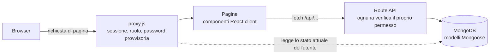

# HomeTab

[English](README.md) · **Italiano**

Un'applicazione web da installare in proprio per tenere traccia delle spese di una famiglia e
capirle: import degli estratti conto con un template per ogni banca, categorizzazione
automatica, report mensili e annuali, obiettivi di risparmio, più utenti con ruoli diversi.

È fatta con Next.js 16 (App Router), MongoDB e NextAuth. Parte con un solo
`docker compose up` e, al primo avvio, contiene già 24 mesi di dati demo realistici.


## Funzionalità

- **Movimenti**: uscite ed entrate con categorie su tre livelli, esercente, luogo, note e metodo
  di pagamento. Ticket restaurant e buoni sono tenuti separati dal denaro, così non falsano il
  calcolo del risparmio.
- **Italiano e inglese**: la lingua segue quella del browser, si cambia in ogni momento e resta
  salvata nel profilo; importi, date, plurali, export Excel ed errori delle API la seguono. I dati
  inseriti (nomi delle categorie, esercenti) restano come sono stati scritti.
- **Import dagli estratti conto**: Excel, CSV o testo incollato. Per ogni banca si definisce un
  template (quale colonna contiene cosa, formato delle date, come leggere il segno degli
  importi), e regole a parole chiave assegnano la categoria. I doppioni si riconoscono prima del
  salvataggio. In modalità demo sono già pronti un template e un estratto conto di esempio per
  provarlo.
- **Report**: dashboard mensile, pivot categorie × mesi, confronto con l'anno precedente per
  categoria, intervalli di date a scelta con proiezione a fine anno. Movimenti, pivot e analisi
  si esportano in Excel.
- **Obiettivi di risparmio**: il risparmio di ogni mese chiuso si ripartisce tra gli obiettivi;
  per ciascuno si vedono la quota mensile che serve e la data prevista di arrivo.
- **Verifica in due passaggi e Telegram**: facoltativa per ogni utente; dopo la password serve
  un codice di 6 cifre su Telegram o via email, e una chat Telegram collegata riceve anche i
  codici di recupero della password ([docs/telegram.md](docs/telegram.md), in inglese). Spenta
  nella demo pubblica.
- **Utenti e ruoli**: lettore, collaboratore e amministratore. Un cambio di ruolo o di password
  vale subito, anche sulle sessioni già aperte.
- **Registro delle attività**, **backup su Google Drive** (manuale o programmato), installabile
  come **PWA**, cinque temi di colore.

| Movimenti | Report per categoria | Obiettivi di risparmio |
| --- | --- | --- |
|  |  |  |

## Avvio rapido

Serve Docker con Compose.

```bash
git clone https://github.com/federicoscimone/HomeTab.git
cd HomeTab
cp .env.example .env      # oppure `npm run setup` (Node 22) per generare segreti casuali
docker compose up -d
```

Apri <http://localhost:3000> ed entra come **mario@test.it** / **Asdf_lkjH**. Il primo avvio
costruisce l'immagine e genera i dati demo: servono alcuni minuti.

La modalità demo (`DEMO_MODE=true`) serve per provare l'app. Per i dati veri impostala a
`false` prima del primo avvio: finché non esiste alcun utente, l'app apre la pagina che crea
l'account amministratore. Le
categorie si creano dalle Impostazioni oppure, lanciando l'app dai sorgenti, con `npm run seed`
(un albero predefinito con le regole a parole chiave) e `node lib/seed-income.js` (categorie delle
entrate). Entrambi non fanno nulla se il database ha già delle categorie.

## Pubblicare una demo

La demo può girare gratis su Vercel con un cluster MongoDB Atlas M0, ripristinata ogni notte da
un cron: vedi [docs/vercel.md](docs/vercel.md) (in inglese).

## Sviluppo in locale

Servono Node.js 22 e un'istanza di MongoDB 7.

```bash
docker run -d --name hometab-mongo -p 27017:27017 mongo:7
cp .env.example .env      # poi togli il commento a MONGODB_URI
npm ci
npm run dev
```

| Comando | Cosa fa |
| --- | --- |
| `npm run dev` | Server di sviluppo sulla porta 3000 |
| `npm test` | Test unitari (test runner integrato in Node) |
| `npm run lint` | ESLint con le regole di Next.js e dei React Hooks |
| `npm run build` | Build di produzione |

`.npmrc` imposta `legacy-peer-deps`: next-auth 4 dichiara nodemailer 7 come dipendenza
facoltativa, mentre l'app usa nodemailer 10.

## Configurazione

Tutto si configura con variabili d'ambiente, descritte una per una in
[`.env.example`](.env.example). Sono obbligatorie solo le credenziali del database e
`NEXTAUTH_SECRET`. Email (per il reset della password) e backup su Google Drive sono facoltativi:
senza, l'app funziona normalmente. Configurazione di Google Drive:
[docs/google-drive.md](docs/google-drive.md).

## Come funziona



Alcune scelte che vale la pena guardare nel codice:

- **Sessioni revocabili.** Il JWT contiene solo l'id dell'utente e una versione di sessione;
  ruolo, stato e password provvisoria si rileggono dal database a ogni richiesta
  ([lib/auth/sessionUser.js](lib/auth/sessionUser.js)). Cambiare password incrementa la
  versione, e tutte le altre sessioni si chiudono subito invece di restare valide per altri 30
  giorni.
- **Una sola tabella dei permessi**, usata da API, proxy delle pagine e interfaccia
  ([lib/auth/permissions.js](lib/auth/permissions.js)). Nascondere un pulsante è una comodità; il
  controllo che conta sta in ogni rotta API.
- **Caricamento dei dati senza condizioni di gara.** I dati di una pagina sono legati alla
  richiesta che li ha prodotti, e una richiesta superata viene annullata: la risposta lenta di un
  filtro vecchio non può sovrascrivere quella attuale
  ([lib/hooks/useApiData.js](lib/hooks/useApiData.js)).
- **Una build del container che non ha bisogno del database.** `BUILD_TARGET=container`,
  impostato solo nello stage di build del Dockerfile, attiva l'output standalone e salta
  l'accesso al database durante la build, mentre altrove lo stesso codice gira invariato
  ([next.config.mjs](next.config.mjs), [Dockerfile](Dockerfile)).
- **La pipeline di import**: lettura guidata dal template, con formati numerici italiano e
  americano, date seriali di Excel e fogli che non partono dalla colonna A, coperta dai test in
  [test/importParser.test.js](test/importParser.test.js).
- **Traduzioni che non possono divergere.** I test verificano che le due lingue abbiano le stesse
  chiavi e gli stessi segnaposto e intercettano gli errori di sintassi ICU; una regola di lint
  rifiuta i testi scritti direttamente nel JSX, così una frase nuova non può uscire in una lingua
  sola ([test/i18n.test.js](test/i18n.test.js)).

## Roadmap

- Import assistito dall'IA con Claude: riconoscimento del template di una banca nuova,
  categorizzazione delle righe che nessuna parola chiave riconosce, con un tetto di spesa mensile
- Un assistente in chat, in sola lettura, che risponde sui dati usando le stesse funzioni dei report
- Confronto con i dati ISTAT sulla spesa delle famiglie italiane simili

## Note di sicurezza

- Gli utenti demo vengono creati solo con `DEMO_MODE=true`, insieme ai dati fittizi: un
  database per uso reale non li contiene.
- I codici inviati su Telegram sono visibili a Telegram: le chat con i bot non sono cifrate
  end-to-end. L'alternativa sono i codici via email.
- `npm audit` non riporta vulnerabilità nelle dipendenze di produzione. Segnala ancora un
  problema di denial of service in `braces`, raggiunto solo dagli strumenti di ESLint, per cui
  non esiste una versione corretta.

## Licenza

[MIT](LICENSE) © Federico Scimone
