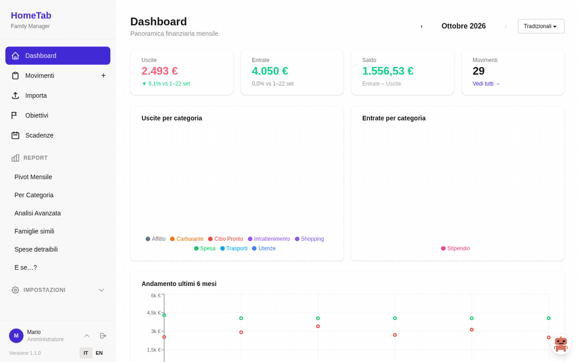
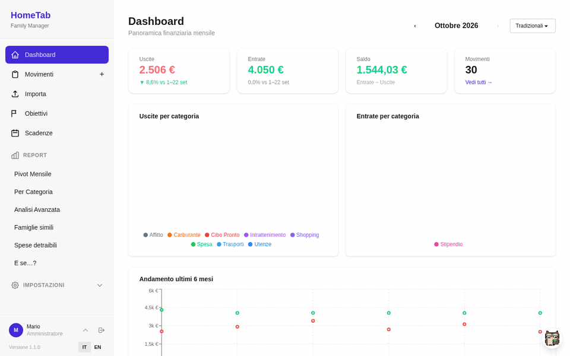
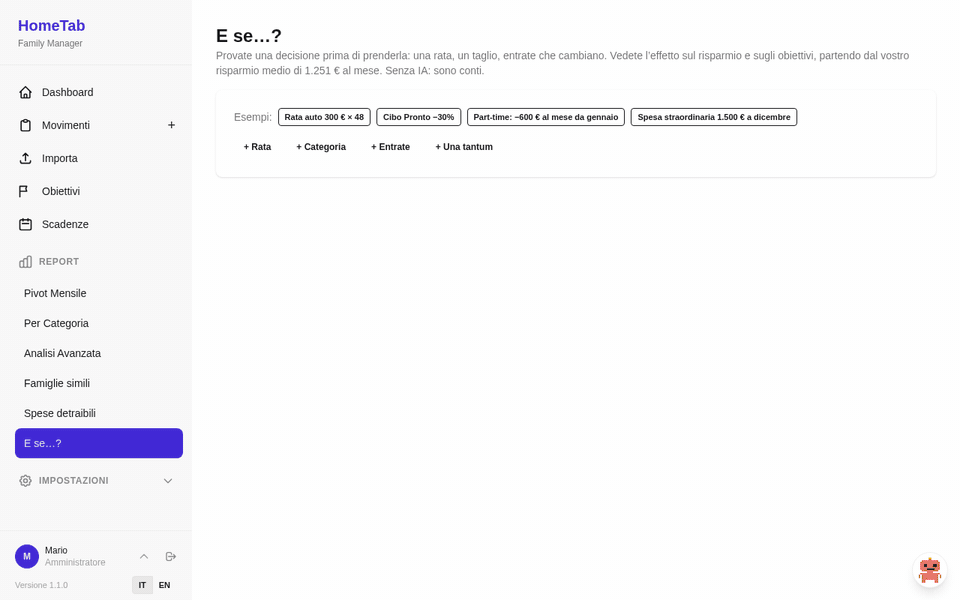
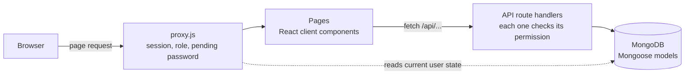

# HomeTab

**English** · [Italiano](README.it.md)

A self-hosted web app to track and plan a family's money: bank statement import with per-bank
templates and automatic categorization, reports, savings goals and family projects, deadlines and
monthly budgets, and an optional AI assistant that answers from the app's own numbers.

Built with Next.js 16 (App Router), MongoDB and NextAuth. It runs with a single
`docker compose up`, and starts with 24 months of realistic demo data. It can live entirely
inside your home — on a mini PC, a NAS or a Raspberry Pi 5 — with the AI on a local model, so the
family's data never leaves the house ([running it at home](#running-it-at-home)).



| Ask your data | What if…? |
| --- | --- |
|  |  |
| The chat, from the owl at the bottom right, answers with tool calls to the reports: every number comes from the code and links to the page that shows it. | Try a decision before taking it: the effect on year-end savings and on when each goal arrives, with no AI. |

## Features

- **Movements** — expenses and income with a three-level category tree, payee, place, notes and
  payment method. Meal tickets and vouchers are tracked apart from money, so they don't distort
  the savings figures.
- **Bank import** — Excel, CSV or pasted text. Each bank gets a template (which column holds
  what, date format, how to read the sign of amounts), and keyword rules assign the category.
  Duplicates are detected before saving. In demo mode a template and a sample bank statement are
  ready to try it.
- **AI-assisted import** — optional: rows that no keyword rule recognises get a category
  suggested by a language model (Claude Haiku 5.5 by default; OpenAI, Gemini, Mistral or a local
  model with Ollama, all through LangChain), learned from
  the family's own past categories, and the merchant is extracted from the bank description;
  for a bank it doesn't know yet, the model proposes the import template, checked against the
  app's parser.
  Personal data is masked before sending, and a hard monthly cap (default $3) is enforced
  atomically; a typical month costs a few cents ([docs/ai.md](docs/ai.md)). Model prices are
  re-read from the providers' official pages on request, each one checked against the page text,
  and kept in a history. Off in the public demo.
- **Chat on your data** — optional, read-only, from the pixel owl at the bottom right: "how much
  will we have saved this year at this pace?", "will we reach our goals?" are answered through
  tool calls to the same functions as the reports, so the model never does the arithmetic, and
  every answer links to the page that shows the same number. Every answer correct on a
  thirteen-question set with Sonnet 5.5, one or two cents per question
  ([docs/ai.md](docs/ai.md#chat-on-the-data)). Off in the public demo.
- **The year at this pace** — on the dashboard, without AI: savings so far, expected at year end
  (remaining months like the same months last year, adjusted for this year's trend, so the
  December bonus counts) against last year, and whether each goal arrives by its deadline.
- **Reports** — monthly dashboard, category × month pivot, year-over-year comparison by
  category, custom date ranges with a year-end projection. Movements, the pivot and the
  custom-range analysis export to Excel.
- **Similar households** — your average monthly spending by category next to the ISTAT average
  for households with the same number of members in your region (2025 survey), from a versioned
  snapshot of ISTAT's SDMX data; housing excludes imputed rent ([docs/istat.md](docs/istat.md)).
- **Saving suggestions, on request** — the code finds subscriptions, growing categories, unusual
  months and gaps from similar households, each with its amount and the months it would gain on a
  goal; the AI picks three and explains them, and any number it invents discards its text
  ([docs/ai.md](docs/ai.md#saving-suggestions-on-request)).
- **Deadlines and set-asides** — bills, taxes, insurance and subscriptions with the monthly amount
  to set aside for the non-monthly ones; recurring payments are found in your movements and
  proposed, payments are recognised, and Telegram reminds you before the due date
  ([docs/planning.md](docs/planning.md)).
- **Quick entry** — on the New movement page, one line ("12,50 pizza", "ieri 40 benzina
  contanti") or a receipt photo (taken with the phone or the webcam, chosen from the gallery or a
  folder, or dragged onto the page) fills in the form, category
  included, to check and save. The same works from the Telegram bot, with an Undo button
  ([docs/telegram.md](docs/telegram.md)).
- **What if…?** — try a decision before taking it: an instalment, a category cut, income that
  changes, a one-off expense; the effect on year-end savings and on when each goal arrives, with
  the same rules as the goals page ([docs/planning.md](docs/planning.md#what-if)).
- **Family projects** — a goal can be split into items with budget and quote, spending tracked
  per item through linked expenses, a warning when an item goes over, and a to-do list with dates
  ([docs/planning.md](docs/planning.md#family-projects)).
- **Deductible expenses (730)** — the year's deductible expenses by type, checked for traceable
  payment (cash medical expenses flagged to check), with the movement list and a CSV for the tax
  return; no tax computation ([docs/planning.md](docs/planning.md#deductible-expenses-730)).
- **Monthly budgets** — a cap per category with the average of the last months as a hint,
  progress and month-end pace on the dashboard, Telegram alerts at 80% and 100%
  ([docs/planning.md](docs/planning.md#monthly-budgets)).
- **Savings goals** — the savings of each closed month are split among goals; every goal shows
  the monthly amount it needs and its estimated arrival date.
- **Two-step verification and Telegram** — optional for each user: after the password, a
  6-digit code on Telegram or by email; a linked Telegram chat also receives password-recovery
  codes ([docs/telegram.md](docs/telegram.md)). Off in the public demo.
- **Users and roles** — viewer, editor and administrator. Role changes and password resets take
  effect immediately, also on sessions that are already open.
- **Italian and English** — the language follows the browser, can be switched at any time and
  is saved on the user's profile; amounts, dates, plurals, Excel exports and API errors follow
  it. Data you enter (category names, payees) stays as written.
- **Audit log**, **Google Drive backup** (manual or scheduled), installable as a **PWA**, five
  colour themes.

| Movements | Category report | Savings goals |
| --- | --- | --- |
|  |  |  |

## Quick start

Requirements: Docker with Compose.

```bash
git clone https://github.com/federicoscimone/HomeTab.git
cd HomeTab
cp .env.example .env      # or `npm run setup` (Node 22) to generate random secrets
docker compose up -d
```

Open <http://localhost:3000> and sign in as **mario@test.it** / **Asdf_lkjH**. The first start
builds the image and generates the demo data, so allow a few minutes.

Demo mode (`DEMO_MODE=true`) is meant for trying the app. For real data set it to `false`
before the first start: with no users yet, the app opens the page that creates the
administrator account. Categories
are created in Settings or, when running from source, with `npm run seed` (a default tree with
keyword rules) and `node lib/seed-income.js` (income categories). Both skip a database that
already has categories.

## Running it at home

For maximum privacy HomeTab runs on a computer of yours, reachable only from the home network
(and from outside through a VPN), with the AI on a **local model through
[Ollama](https://ollama.com)**: receipts, import and chat then work without anything leaving the
house, at no cost. Paid providers remain an option, with personal data masked before sending.

It also runs on a **Raspberry Pi 5** (4 GB at least, 8 GB recommended, with an SSD). Not on a
Pi 4 or older: MongoDB 5.0 and later need an ARMv8.2-A processor, which the Pi 4 lacks. On the
Pi the local models run on the processor and are slow; Ollama on a PC with a graphics card in
the same house is the better pairing.

Backups on your own disks, MongoDB's memory on a small board, the Pi 5's kernel and HTTPS in the
home network: [docs/self-hosting.md](docs/self-hosting.md). AI providers and local models:
[docs/ai.md](docs/ai.md).

## Deploying a public demo

The demo can run for free on Vercel with a MongoDB Atlas M0 cluster, restored every night by a
cron job: see [docs/vercel.md](docs/vercel.md).

## Local development

Requirements: Node.js 22 and a MongoDB 7 instance.

```bash
docker run -d --name hometab-mongo -p 27017:27017 mongo:7
cp .env.example .env      # then uncomment MONGODB_URI
npm ci
npm run dev
```

| Command | What it does |
| --- | --- |
| `npm run dev` | Development server on port 3000 |
| `npm test` | Unit tests (Node's built-in test runner) |
| `npm run lint` | ESLint with the Next.js and React Hooks rules |
| `npm run build` | Production build |

`.npmrc` sets `legacy-peer-deps`: next-auth 4 declares nodemailer 7 as an optional peer, while
the app uses nodemailer 10.

## Configuration

Everything is configured through environment variables, documented one by one in
[`.env.example`](.env.example). Only the database credentials and `NEXTAUTH_SECRET` are required.
Email (for password reset) and Google Drive backup are optional: without them the app works
normally. Google Drive setup: [docs/google-drive.md](docs/google-drive.md).

## How it works



A few decisions worth a look in the code:

- **Sessions that can be revoked.** The JWT carries only the user id and a session version;
  role, active flag and pending password are read from the database on every request
  ([lib/auth/sessionUser.js](lib/auth/sessionUser.js)). Changing a password bumps the version,
  so every other session ends at once instead of living for 30 more days.
- **One permission table** used by the API, the page proxy and the UI
  ([lib/auth/permissions.js](lib/auth/permissions.js)). Hiding a button is a convenience; the
  check that matters is in each API route.
- **Data loading without races.** A page's data is tied to the request that produced it, and a
  superseded request is aborted, so a slow answer for an old filter can't overwrite the current
  one ([lib/hooks/useApiData.js](lib/hooks/useApiData.js)).
- **A container build that needs no database.** `BUILD_TARGET=container`, set only in the
  Dockerfile build stage, enables the standalone output and skips database access during the
  build, while the same code runs unchanged elsewhere ([next.config.mjs](next.config.mjs),
  [Dockerfile](Dockerfile)).
- **Import pipeline**: template-driven parsing with Italian and US number formats, Excel serial
  dates and sheets that don't start in column A, tested in
  [test/importParser.test.js](test/importParser.test.js).
- **Translations that can't drift.** Tests check that both languages have the same keys and
  placeholders and catch ICU syntax mistakes; a lint rule rejects any text written directly in
  JSX, so a new sentence can't ship in one language only ([test/i18n.test.js](test/i18n.test.js)).

## Roadmap

- Learned rules: keywords proposed from the AI suggestions the family accepts

## Security notes

- The demo users are created only with `DEMO_MODE=true`, together with the fictitious data;
  a database for real use never contains them.
- Codes sent through Telegram are visible to Telegram: bot chats are not end-to-end encrypted.
  Email codes are the alternative ([docs/telegram.md](docs/telegram.md#limits)).
- `npm audit` reports no vulnerabilities in production dependencies. It still lists a
  denial-of-service issue in `braces`, reached only through the ESLint toolchain, for which no
  fixed version exists.

## License

[MIT](LICENSE) © Federico Scimone
