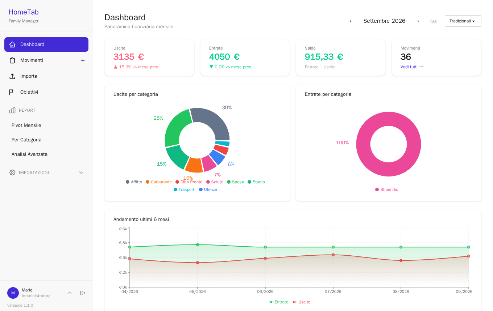
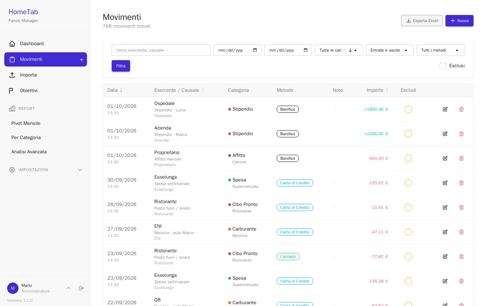
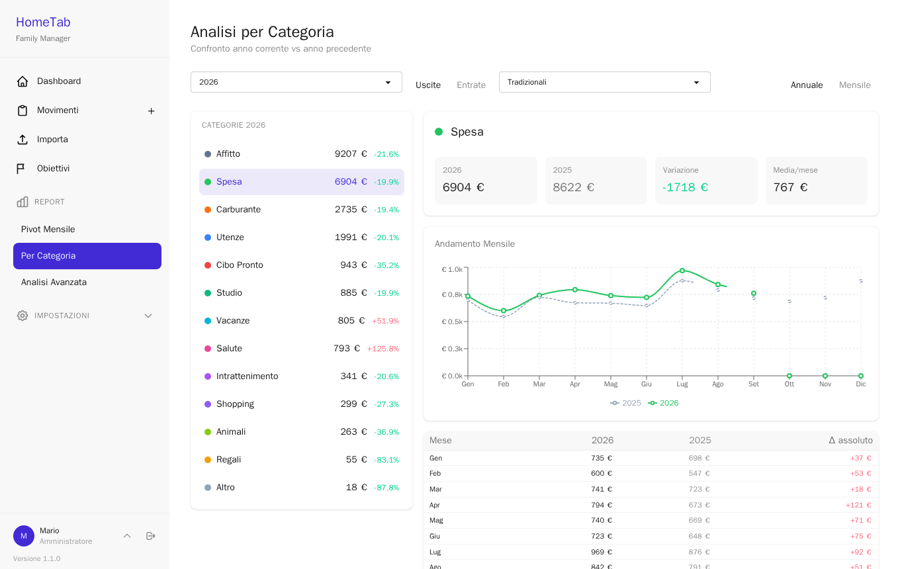
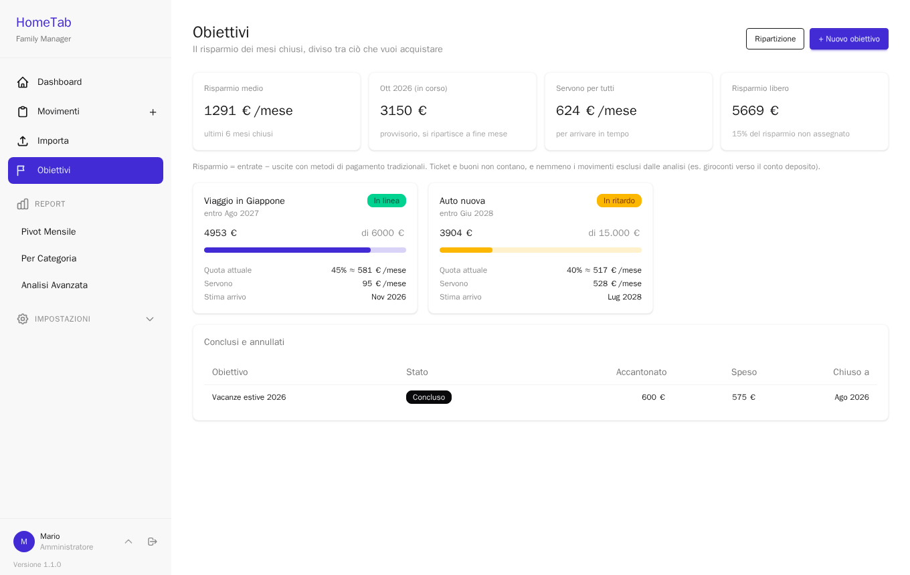
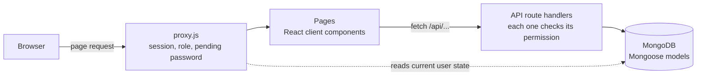

# HomeTab

**English** · [Italiano](README.it.md)

A self-hosted web app to track and understand a family's spending: bank statement import with
per-bank templates, automatic categorization, monthly and yearly reports, savings goals and
multiple users with roles.

Built with Next.js 16 (App Router), MongoDB and NextAuth. It runs with a single
`docker compose up`, and starts with 24 months of realistic demo data.



## Features

- **Movements** — expenses and income with a three-level category tree, payee, place, notes and
  payment method. Meal tickets and vouchers are tracked apart from money, so they don't distort
  the savings figures.
- **Bank import** — Excel, CSV or pasted text. Each bank gets a template (which column holds
  what, date format, how to read the sign of amounts), and keyword rules assign the category.
  Duplicates are detected before saving. In demo mode a template and a sample bank statement are
  ready to try it.
- **AI-assisted import** — optional: rows that no keyword rule recognises get a category
  suggested by a language model (Claude Haiku 5.5 by default, through LangChain), learned from
  the family's own past categories, and the merchant is extracted from the bank description;
  for a bank it doesn't know yet, the model proposes the import template, checked against the
  app's parser.
  Personal data is masked before sending, and a hard monthly cap (default $3) is enforced
  atomically; a typical month costs a few cents ([docs/ai.md](docs/ai.md)). Off in the public
  demo.
- **Chat on your data** — optional, read-only: questions like "how much did we spend on
  restaurants this year compared with last year?" are answered through tool calls to the same
  functions as the reports, so the model never does the arithmetic, and every answer links to the
  page that shows the same number. Every answer correct over four runs of an eleven-question set,
  one or two cents per question ([docs/ai.md](docs/ai.md#chat-on-the-data)). Off in the public demo.
- **Reports** — monthly dashboard, category × month pivot, year-over-year comparison by
  category, custom date ranges with a year-end projection. Movements, the pivot and the
  custom-range analysis export to Excel.
- **Similar households** — your average monthly spending by category next to the ISTAT average
  for households with the same number of members in your region (2025 survey), from a versioned
  snapshot of ISTAT's SDMX data; housing excludes imputed rent ([docs/istat.md](docs/istat.md)).
- **Savings goals** — the savings of each closed month are split among goals; every goal shows
  the monthly amount it needs and its estimated arrival date.
- **Two-step verification and Telegram** — optional for each user: after the password, a
  6-digit code on Telegram or by email; a linked Telegram chat also receives password-recovery
  codes ([docs/telegram.md](docs/telegram.md)). Off in the public demo.
- **Users and roles** — viewer, editor and administrator. Role changes and password resets take
  effect immediately, also on sessions that are already open.
- **Italian and English** — the language follows the browser, can be switched at any time and
  is saved on the user's profile; amounts, dates, plurals, Excel exports and API errors follow
  it. Data you enter (category names, payees) stays as written.
- **Audit log**, **Google Drive backup** (manual or scheduled), installable as a **PWA**, five
  colour themes.

| Movements | Category report | Savings goals |
| --- | --- | --- |
|  |  |  |

## Quick start

Requirements: Docker with Compose.

```bash
git clone https://github.com/federicoscimone/HomeTab.git
cd HomeTab
cp .env.example .env      # or `npm run setup` (Node 22) to generate random secrets
docker compose up -d
```

Open <http://localhost:3000> and sign in as **mario@test.it** / **Asdf_lkjH**. The first start
builds the image and generates the demo data, so allow a few minutes.

Demo mode (`DEMO_MODE=true`) is meant for trying the app. For real data set it to `false`
before the first start: with no users yet, the app opens the page that creates the
administrator account. Categories
are created in Settings or, when running from source, with `npm run seed` (a default tree with
keyword rules) and `node lib/seed-income.js` (income categories). Both skip a database that
already has categories.

## Deploying a public demo

The demo can run for free on Vercel with a MongoDB Atlas M0 cluster, restored every night by a
cron job: see [docs/vercel.md](docs/vercel.md).

## Local development

Requirements: Node.js 22 and a MongoDB 7 instance.

```bash
docker run -d --name hometab-mongo -p 27017:27017 mongo:7
cp .env.example .env      # then uncomment MONGODB_URI
npm ci
npm run dev
```

| Command | What it does |
| --- | --- |
| `npm run dev` | Development server on port 3000 |
| `npm test` | Unit tests (Node's built-in test runner) |
| `npm run lint` | ESLint with the Next.js and React Hooks rules |
| `npm run build` | Production build |

`.npmrc` sets `legacy-peer-deps`: next-auth 4 declares nodemailer 7 as an optional peer, while
the app uses nodemailer 10.

## Configuration

Everything is configured through environment variables, documented one by one in
[`.env.example`](.env.example). Only the database credentials and `NEXTAUTH_SECRET` are required.
Email (for password reset) and Google Drive backup are optional: without them the app works
normally. Google Drive setup: [docs/google-drive.md](docs/google-drive.md).

## How it works



A few decisions worth a look in the code:

- **Sessions that can be revoked.** The JWT carries only the user id and a session version;
  role, active flag and pending password are read from the database on every request
  ([lib/auth/sessionUser.js](lib/auth/sessionUser.js)). Changing a password bumps the version,
  so every other session ends at once instead of living for 30 more days.
- **One permission table** used by the API, the page proxy and the UI
  ([lib/auth/permissions.js](lib/auth/permissions.js)). Hiding a button is a convenience; the
  check that matters is in each API route.
- **Data loading without races.** A page's data is tied to the request that produced it, and a
  superseded request is aborted, so a slow answer for an old filter can't overwrite the current
  one ([lib/hooks/useApiData.js](lib/hooks/useApiData.js)).
- **A container build that needs no database.** `BUILD_TARGET=container`, set only in the
  Dockerfile build stage, enables the standalone output and skips database access during the
  build, while the same code runs unchanged elsewhere ([next.config.mjs](next.config.mjs),
  [Dockerfile](Dockerfile)).
- **Import pipeline**: template-driven parsing with Italian and US number formats, Excel serial
  dates and sheets that don't start in column A, tested in
  [test/importParser.test.js](test/importParser.test.js).
- **Translations that can't drift.** Tests check that both languages have the same keys and
  placeholders and catch ICU syntax mistakes; a lint rule rejects any text written directly in
  JSX, so a new sentence can't ship in one language only ([test/i18n.test.js](test/i18n.test.js)).

## Roadmap

- Saving suggestions: signals computed by the code (subscriptions, growing categories, gaps from
  similar households), ranked and explained by the AI

## Security notes

- The demo users are created only with `DEMO_MODE=true`, together with the fictitious data;
  a database for real use never contains them.
- Codes sent through Telegram are visible to Telegram: bot chats are not end-to-end encrypted.
  Email codes are the alternative ([docs/telegram.md](docs/telegram.md#limits)).
- `npm audit` reports no vulnerabilities in production dependencies. It still lists a
  denial-of-service issue in `braces`, reached only through the ESLint toolchain, for which no
  fixed version exists.

## License

[MIT](LICENSE) © Federico Scimone
