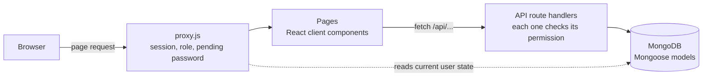

# HomeTab

**English** · [Italiano](README.it.md)

A self-hosted web app to track and understand a family's spending: bank statement import with
per-bank templates, automatic categorization, monthly and yearly reports, savings goals and
multiple users with roles.

Built with Next.js 16 (App Router), MongoDB and NextAuth. It runs with a single
`docker compose up`, and starts with 24 months of realistic demo data.


> The interface is in Italian for now: it was built for an Italian household and Italian banks.
> A language selector (Italian and English) is next on the [roadmap](#roadmap).

## Features

- **Movements** — expenses and income with a three-level category tree, payee, place, notes and
  payment method. Meal tickets and vouchers are tracked apart from money, so they don't distort
  the savings figures.
- **Bank import** — Excel, CSV or pasted text. Each bank gets a template (which column holds
  what, date format, how to read the sign of amounts), and keyword rules assign the category.
  Duplicates are detected before saving.
- **Reports** — monthly dashboard, category × month pivot, year-over-year comparison by
  category, custom date ranges with a year-end projection. Movements, the pivot and the
  custom-range analysis export to Excel.
- **Savings goals** — the savings of each closed month are split among goals; every goal shows
  the monthly amount it needs and its estimated arrival date.
- **Users and roles** — viewer, editor and administrator. Role changes and password resets take
  effect immediately, also on sessions that are already open.
- **Audit log**, **Google Drive backup** (manual or scheduled), installable as a **PWA**, five
  colour themes.

| Movements | Category report | Savings goals |
| --- | --- | --- |
|  |  |  |

## Quick start

Requirements: Docker with Compose.

```bash
git clone https://github.com/federicoscimone/HomeTab.git
cd HomeTab
cp .env.example .env      # or `npm run setup` (Node 22) to generate random secrets
docker compose up -d
```

Open <http://localhost:3000> and sign in as **mario@test.it** / **Asdf_lkjH**. The first start
builds the image and generates the demo data, so allow a few minutes.

Demo mode (`DEMO_MODE=true`) is meant for trying the app. Set it to `false` in `.env` before
entering real data.

## Local development

Requirements: Node.js 22 and a MongoDB 7 instance.

```bash
docker run -d --name hometab-mongo -p 27017:27017 mongo:7
cp .env.example .env      # then uncomment MONGODB_URI
npm ci
npm run dev
```

| Command | What it does |
| --- | --- |
| `npm run dev` | Development server on port 3000 |
| `npm test` | Unit tests (Node's built-in test runner) |
| `npm run lint` | ESLint with the Next.js and React Hooks rules |
| `npm run build` | Production build |

`.npmrc` sets `legacy-peer-deps`: next-auth 4 declares nodemailer 7 as an optional peer, while
the app uses nodemailer 10.

## Configuration

Everything is configured through environment variables, documented one by one in
[`.env.example`](.env.example). Only the database credentials and `NEXTAUTH_SECRET` are required.
Email (for password reset) and Google Drive backup are optional: without them the app works
normally. Google Drive setup: [docs/google-drive.md](docs/google-drive.md).

## How it works



A few decisions worth a look in the code:

- **Sessions that can be revoked.** The JWT carries only the user id and a session version;
  role, active flag and pending password are read from the database on every request
  ([lib/auth/sessionUser.js](lib/auth/sessionUser.js)). Changing a password bumps the version,
  so every other session ends at once instead of living for 30 more days.
- **One permission table** used by the API, the page proxy and the UI
  ([lib/auth/permissions.js](lib/auth/permissions.js)). Hiding a button is a convenience; the
  check that matters is in each API route.
- **Data loading without races.** A page's data is tied to the request that produced it, and a
  superseded request is aborted, so a slow answer for an old filter can't overwrite the current
  one ([lib/hooks/useApiData.js](lib/hooks/useApiData.js)).
- **A container build that needs no database.** `BUILD_TARGET=container`, set only in the
  Dockerfile build stage, enables the standalone output and skips database access during the
  build, while the same code runs unchanged elsewhere ([next.config.mjs](next.config.mjs),
  [Dockerfile](Dockerfile)).
- **Import pipeline**: template-driven parsing with Italian and US number formats, Excel serial
  dates and sheets that don't start in column A, tested in
  [test/importParser.test.js](test/importParser.test.js).

## Roadmap

- Language selector: Italian and English
- Optional two-factor authentication and password reset through a Telegram bot
- AI-assisted import with Claude: template detection for a new bank, categorization of the rows
  that no keyword matches, with a hard monthly spending cap
- A read-only chat assistant that answers questions on your data using the same functions as the
  reports
- Comparison with ISTAT data on the spending of similar Italian households

## Security notes

- The demo users are created only with `DEMO_MODE=true`, together with the fictitious data;
  a database for real use never contains them.
- `npm audit` reports no vulnerabilities in production dependencies. It still lists a
  denial-of-service issue in `braces`, reached only through the ESLint toolchain, for which no
  fixed version exists.

## License

[MIT](LICENSE) © Federico Scimone
